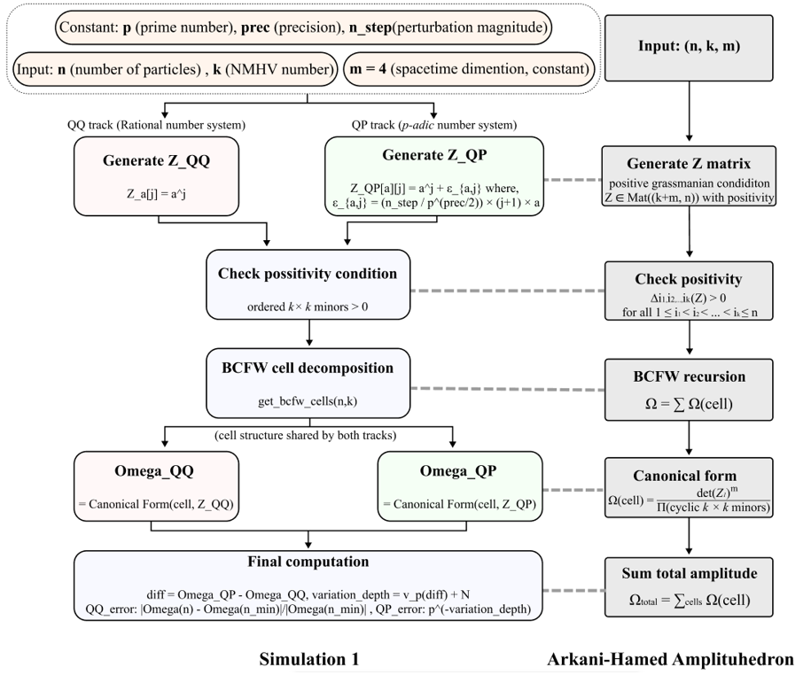
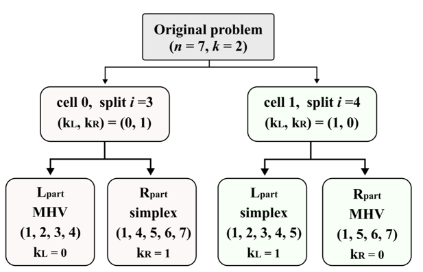
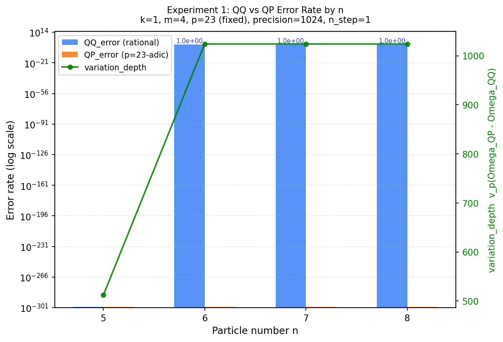

# p-adic Structure of the Amplituhedron

Source code for the undergraduate thesis
**On the Origin of Quantum Discreteness in Plasma Electron Scattering. A Non-Archimedean Exploration of the Amplituhedron and Its p-adic Structure**
(Sung-hyuk Yoon, Dongguk University, 2026. Supervised by Dr. Jeon ByungHoon.)

📄 [Read the full thesis (PDF, 106 pages)](thesis.pdf)

This PDF is the author's typeset version. The version submitted to Dongguk University follows the university's format and is featured on the author's [LinkedIn profile](https://www.linkedin.com/in/sunghyuk-yoon-3a1319383/).

> **Note.** The author now considers that the central method of this thesis cannot test its own hypothesis. The [Retrospective](#retrospective) section, placed right after the findings, explains why.

## Motivation

As semiconductor processes approach the nanometer scale, stochastic fluctuation sets a limit that precise control does not remove.
This thesis asks a question one step behind that limit.
Probability in the microscopic world may not be a feature of nature itself.
It may instead be noise from describing nature in the language of real numbers.
The amplituhedron, a geometric object that encodes scattering amplitudes, gives a setting where this idea can be tested by exact computation.

## Overview

The code computes the canonical form of the amplituhedron in two parallel tracks.
The QQ track works in exact rational arithmetic.
The QP track adds a p-adically scaled perturbation to the same input.
Both tracks are exact, so the comparison is not a comparison of floating-point error.
The difference between the two tracks is read through its p-adic valuation instead of its magnitude.



*Flowchart of the simulation (left) and its correspondence with the amplituhedron construction of Arkani-Hamed and Trnka (right).*

## Findings reported in the thesis

The QP track does not compute the amplitude more precisely than the QQ track.
Both tracks carry rational entries, and neither approximates anything.

Read through the p-adic valuation, the two tracks show a definite structure.
At k = 1 the amplitude reduces to the number of cells for n ≥ 6, so the two tracks return the same value.
At k = 2 the behavior divides sharply between n = 7 and n = 8.
Below this threshold the valuation of the difference equals the valuation of the amplitude.

| (n, k) | v₂(Ω_QP − Ω_QQ) | v₂(Ω_QQ) |
|---|---|---|
| (5, 1) | 20 | 20 |
| (6, 2) | 32 | 32 |
| (7, 2) | 21 | 21 |

The agreement does not depend on the size of the perturbation.
It holds at a single value across thirty combinations of n_step and precision.
It disappears when the perturbation is scaled to a prime other than the one used for the valuation.

The structure has a traceable origin.
On the moment curve, the numerator of each cell is a Vandermonde determinant.
The prime content of the amplitude is inherited from the differences of small integers in that determinant.

## Retrospective

> This section is the author's own critique, written after the thesis was submitted. It is the most important part of this repository.

### What the thesis set out to test

The thesis asked whether probability in microscopic physics could be an artifact of describing nature with real numbers.
To test this, it computed the same amplitude in two tracks, QQ and QP, and compared them.
The plan works only if the two tracks can, in principle, return different answers.
They cannot.

### Why the two tracks cannot differ

Both tracks take rational inputs.
Both use only addition, subtraction, multiplication and division, carried out exactly with Python's `Fraction`.
A finite chain of these operations on rational numbers always ends in a rational number.
The rationals $\mathbb{Q}$ sit inside the reals $\mathbb{R}$ and inside the p-adic numbers $\mathbb{Q}_p$ in the same way.
The same rational result is therefore the same number whether it is read as real or as p-adic.

By Ostrowski's theorem, the real and the p-adic absolute values are the only two kinds of completion of $\mathbb{Q}$.
The two completions differ only beyond $\mathbb{Q}$, in limits, infinite series and numbers that are not rational.
The computation never leaves $\mathbb{Q}$.
It never reaches the place where the two number systems could differ.

### What the QP track actually is

The QP track is not a computation in $\mathbb{Q}_p$.
It is the same rational computation applied to a slightly different rational input.
The comparison between QQ and QP is a comparison between two inputs, not between two number systems.

### The perturbation follows real-number intuition

The QP input adds $\varepsilon = n_{\text{step}}\,(j+1)\,a \,/\, p^{\,\text{prec}/2}$ to each entry of $Z$.
In the real absolute value this quantity is tiny.
In the p-adic absolute value it is large, as large as $p^{\,\text{prec}/2}$.
A perturbation that is small in the p-adic sense would be scaled by $p^{N}$, not by $1/p^{N}$.
The perturbation named p-adic is small only in the real sense.

### What the valuation actually measured

The p-adic valuation $v_p$ is defined on rational numbers themselves.
Reading $v_p$ of a rational output requires no p-adic arithmetic.
It only counts the factors of $p$ in the numerator and the denominator.

On the moment curve $Z_a^{\,j} = a^{\,j}$, the numerator of each cell is a Vandermonde determinant $\prod_{i<j}(a_j - a_i)$.
Its prime content comes from differences of the small integers $1, \dots, n$.
For example, $\Omega(5,1) = 288^4 = 2^{20}\cdot 3^{8}$.
The valuations reported in the thesis are inherited from these integers.
They describe the arithmetic of the chosen input, not a property of a number system.

The coincidence $v_p(\Omega_{QP}-\Omega_{QQ}) = v_p(\Omega_{QQ})$ is likewise a fact about how this rational function responds to this rational change of input.
It holds as arithmetic.
It is not evidence about $\mathbb{R}$ versus $\mathbb{Q}_p$.

### What still holds

The negative results stand.
The QP track does not compute the amplitude more precisely, and no probabilistic uncertainty is reduced.
The implementation is correct as an exact computation of BCFW canonical forms for small $n$ and $k$, and it passes the invariants of Appendix D.
The arithmetic observations are true statements about these amplitudes.
One example is that $\Omega(5,1)$ reappears as the common divisor of both cells of $\Omega(7,2)$.

The original question remains open.
This study did not answer it, because it never posed the question in a form a computation could decide.

### What a real test would require

A test needs a step where $\mathbb{R}$ and $\mathbb{Q}_p$ give different answers.
Such steps exist.
The series $\sum_{r \ge 0} p^{r}$ diverges in $\mathbb{R}$ but converges to $1/(1-p)$ in $\mathbb{Q}_p$.
The equation $x^2 = -1$ has no solution in $\mathbb{R}$ but has one in $\mathbb{Q}_5$.
A meaningful comparison would place a difference of this kind inside the computation, through inputs or limits that exist in one completion and not in the other.
The inverse problem named in the thesis conclusion is one candidate.
Recovering an input from an amplitude means solving equations, and the solution sets of an equation can differ between the two completions.

### Lesson

An experiment must be able to return different outcomes under the hypotheses it compares.
This study did not check that condition before running.
The computation was correct.
Its outcome was fixed by the setup before it ran.

## Algorithm

The implementation follows the five-step algorithm of Section 3.3.3 of the thesis.

1. Generate the moment-curve matrix Z.
2. Test the positivity condition on the ordered maximal minors of Z.
3. Decompose the amplituhedron into BCFW cells.
4. Evaluate the canonical form of each cell.
5. Sum the cell contributions into the total amplitude.



*BCFW recursion tree for (n, k) = (7, 2). Each leaf is a base case, either an MHV cell or a simplex cell.*

## Why plain Python instead of SageMath

The computation only needs exact rational arithmetic and p-adic valuations.
Python's standard `fractions` module provides the first.
The second is implemented directly in a few lines.
The SageMath objects `QQ`, `Qp` and `matrix(QQ, ...)` are therefore replaced by small standalone classes.
The code runs with NumPy and Matplotlib only.

## Files

| File | Content |
|---|---|
| `experiment1_standalone.py` | Core implementation and Experiment 1 (QQ vs QP as the particle number n grows) |
| `experiment2_matrix.py` | Experiment 2 (grid over precision and n_step). Imports the functions of Experiment 1 |
| `requirements.txt` | Package versions the code was tested with |
| `simulation_algorithm.png`, `bcfwtree.png`, `experiment1_result.png` | Flowchart, recursion tree and output plot |
| `thesis.pdf`, `summary.pdf` | Full text of the thesis and a five-page summary |

## How to run

```bash
pip install -r requirements.txt
python experiment1_standalone.py
python experiment2_matrix.py
```

Tested on Python 3.12 with NumPy 2.4.4 and Matplotlib 3.10.8.
Each script finishes in under 10 seconds on a laptop.
Experiment 1 writes `experiment1_log.json` and `experiment1_result.png`.
Experiment 2 writes its logs to `exp2_logs/`.

## Reading the output

The scripts report a relative depth, not the raw valuation.
The relative depth equals v_p(Ω_QP − Ω_QQ) + prec/2.
Subtracting prec/2 recovers the values in the table above.
For example, Experiment 2 reports a depth of 52, 84 and 148 for (5, 1) at prec = 64, 128 and 256.
Each gives v₂ = 20 after the subtraction.
When the two tracks agree exactly, the scripts report the depth as prec by convention.

Experiment 1 with default settings (k = 1, p = 23, n = 5 to 8) produces the plot below.



## Verification

The implementation is checked against the invariants listed in Appendix D of the thesis.
Invariant I-1 is reproduced exactly.
For (n, k, m) = (5, 1, 4) the code returns Ω = 288⁴ = 6,879,707,136.

## Thesis summary

A five-page summary of the thesis is available for a quicker read.

📄 [Read the summary (PDF)](summary.pdf)

## Citation

```bibtex
@thesis{yoon2026padic,
  author = {Yoon, Sung-hyuk},
  title  = {On the Origin of Quantum Discreteness in Plasma Electron Scattering:
            A Non-Archimedean Exploration of the Amplituhedron and Its p-adic Structure},
  school = {Dongguk University},
  type   = {Undergraduate thesis},
  year   = {2026}
}
```
